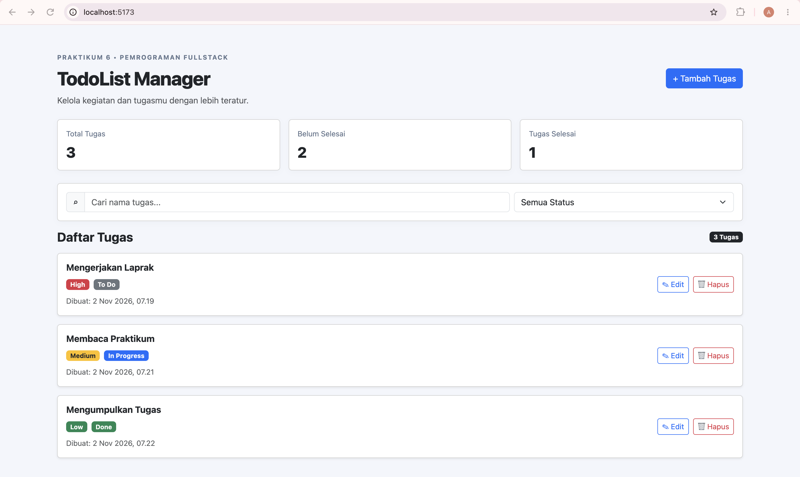

# TodoList Manager - React 19

Aplikasi TodoList Manager dibuat untuk memenuhi
Tugas Praktikum 6 mata kuliah Pemrograman Full Stack.

## Deskripsi

TodoList Manager merupakan aplikasi pengelolaan tugas
berbasis web yang memungkinkan pengguna untuk
menambahkan, melihat, mengedit, dan menghapus tugas.

## Fitur Aplikasi

1. Create, Read, Update, dan Delete (CRUD).
2. Badge prioritas High, Medium, dan Low.
3. Indikator status To Do, In Progress, dan Done.
4. Menampilkan waktu pembuatan tugas.
5. Pencarian berdasarkan nama tugas.
6. Filter berdasarkan status tugas.
7. Ringkasan total tugas.
8. Tampilan responsif menggunakan Bootstrap.

## Teknologi yang Digunakan

- React JS 19
- Vite
- JavaScript
- Bootstrap
- React-Bootstrap

## Screenshot Aplikasi



## Cara Menjalankan Aplikasi

Clone repository:

```bash
git clone https://github.com/4rzaal/react-todolist-crud.git
```

Masuk ke folder proyek:

```bash
cd react-todolist-crud
```

Instal dependensi:

```bash
npm install
```

Jalankan aplikasi:

```bash
npm run dev
```

## Pengembang

Mata Kuliah: Pemrograman Full Stack

Praktikum: Pertemuan 6 - React JS

## Lisensi

Proyek ini dibuat untuk kebutuhan pembelajaran
dan tugas praktikum.
